# Abstract

Formula 1 racing couples two sequential decision problems on different clocks: a
driver who must overtake and defend at the grip limit without contact, and a
strategist who chooses pit laps, tyres and push levels under safety cars, rain and
incidents. Rule-based plans cannot react to such events, and end-to-end RL drivers
learn slowly and lack hard safety. We build a seeded Gymnasium simulator on 25
real circuits and train a two-level PPO hierarchy. Its novelty lies in (i) a driver
that selects temporally extended race-craft moves executed by a limit-pace path
planner and filtered by a bilateral predictive safety shield, (ii) a curriculum
seeded with real 2021-2025 overtakes used as start states rather than imitation
targets, and (iii) a strategist trained on a profile measured from the learned
driver. Against rule-based baselines on five unseen circuits, the driver records
zero contacts in 1,174 real situations and holds 273 of 460 defences versus 264,
while pure soft actor-critic plateaued 17-20% off the limit lap. One strategist
covering eight race cases wins at least as often as a rule-based plan in seven of
them on unseen circuits, including 89.5% versus 66.5% in the rain and 38.5% versus
13% after a spin.

**Keywords:** reinforcement learning, hierarchical control, PPO, safe RL, shielding,
autonomous racing, race strategy, curriculum learning, Formula 1.

## 1.1 Background and Context

Reinforcement learning (RL) studies how an agent should act in an environment to
maximise long-run reward [1]. At each step $t$ the agent observes a state $s_t$,
draws an action $a_t$ from its policy $\pi_\theta(a\mid s)$, and the environment
returns a scalar reward $r_t$ and a new state $s_{t+1}$. The problem is usually
written as a Markov decision process $(\mathcal S,\mathcal A,P,R,\gamma)$, and the
goal is a policy that maximises the discounted return
$G_t=\sum_{k\ge 0}\gamma^k r_{t+k}$. Because the agent learns from consequences
rather than labelled answers, RL suits problems in which an early choice only pays
off (or fails) many steps later. Deep networks made it practical for large state
spaces: deep Q-networks learned Atari games from pixels [2], search plus policy
networks mastered Go [3], and multi-agent RL reached grandmaster level in
StarCraft II [4]. The same tools now appear in robot control [5], automated
driving [6], drone racing [7] and planning problems where a model of the future is
cheap to simulate but hard to solve analytically.

Motorsport is a natural but demanding test bed for these methods. A racing car is
driven at the edge of tyre grip, where a small error ends the lap, and the reward
for a good braking point is felt seconds later. Racing against others adds
interaction: the car ahead shapes your air flow, your line and your options, and a
collision is costly for both. Above the driver sits a slower layer of decisions -
when to pit, which compound to fit, how hard to push - whose consequences unfold
over a whole race and depend on what rivals do and on random events such as safety
cars and showers. The key domain challenges are therefore (a) long horizons with
delayed reward, (b) hard safety constraints, (c) other agents whose behaviour
changes the problem, (d) two decision rates that differ by two orders of magnitude,
and (e) scarce real data: public F1 telemetry has no steering signal and positions
are sampled at only a few hertz.

## 1.2 Problem Statement

We address the following sequential decision problem. Given a circuit, a car model
with a friction-ellipse grip limit and tyre wear, and a field of rival cars, learn
(1) a **Driver Agent** policy that every 0.5 s chooses a race-craft move (follow
the racing line, pull out of the slipstream, take a lane beside the car ahead,
cover, take the inside, feint and similar) so that the car laps near the
physical limit, completes clean overtakes, and defends its position with **zero
contacts**; and (2) a **Strategy Agent** policy that once per lap chooses whether
to pit, which compound to fit, and a push level, so that the car finishes a full
Grand Prix as early as possible and ideally wins, under safety-car, virtual
safety-car, rain, spin and puncture events. Both policies must generalise to
circuits never seen in training.

## 1.3 Motivation

Race engineering still leans on hand-written rules and Monte-Carlo race simulation
[8], [27]. A fixed plan such as "start on mediums, change to hards at 45% race
distance" is easy to explain but ignores the state of the race: it does not bring
a stop forward under a safety car, it cannot react to a spin, and it never
undercuts deliberately. Supervised learning can copy what teams did [10], but the
labels encode those teams' cars, rivals and risk preferences, and there is no
label for "the decision that would have been better". On the driving side, optimal
control computes excellent single-car laps [11], [12] but becomes hard to solve once
another car's intent is unknown; end-to-end RL can learn superhuman lap times in a
high-fidelity game [13], [14], yet the published systems needed large compute
budgets and still had to be taught etiquette through carefully weighted penalties.

RL is attractive here because the simulator gives unlimited, cheap experience,
the objective (finish first, cleanly) is easy to state as reward, and the learned
policy reacts to whatever state it finds itself in. The remaining gaps that
motivate this work are: how to make RL learn clean wheel-to-wheel racing without an
industrial compute budget, how to use real race data that lacks control signals,
and how to make a strategist's decisions consistent with what its own driver can
actually do.

## 1.4 Objectives

1. Build a fast, seeded Gymnasium simulator on real circuit geometry with a
   friction-ellipse car, tyre wear, slipstream, dirty air and aerodynamic drag.
2. Design a Driver Agent whose actions are race-craft moves rather than raw
   pedals, so that exploration happens at the level of tactics.
3. Create reward functions that pay for progress and for overtakes that stick,
   and that charge for contact, unsafe proximity and lost places.
4. Keep learning stable and safe with a predictive safety shield, behaviour-cloned
   warm starts and real-race start states.
5. Beat rule-based baselines: a scripted tactician and line-holding defender for
   the driver, and a fixed one-stop plan for the strategist.
6. Approach the best achievable result: the optimal-line limit lap for pace and a
   100% win rate for the strategist where the car allows it.

## 1.5 Contributions

1. **A move-level driver policy on top of a physics-aware path planner.** The PPO
   driver chooses among 17 temporally extended options (racing line, pull-out,
   four lane offsets with normal or late braking, cover, inside, feint, switchback
   and others); a planner then drives the chosen path at the grip limit. This turns
   a continuous control problem in which pure soft actor-critic plateaued 17-20%
   off the limit lap into a tactical choice made on top of a planner that, driving
   alone, laps within 1.1% of the limit.
2. **A bilateral predictive safety shield.** Every candidate command of every car
   is accepted only if both cars could still fall back on a rule-of-the-road
   manoeuvre (the car behind brakes, the car ahead keeps its lane) without
   touching; otherwise the least intrusive safe command replaces it. Contacts on
   424 held-out real starts fall from 20 to 0, and the trained driver keeps zero
   contacts on all 1,174 held-out real starts.
3. **A real-incident curriculum without imitation.** Passes and defences from real
   2021-2025 races (FastF1 and OpenF1 timing) are mapped onto the simulator's
   circuits and used as episode start states and as a held-out test set, which
   avoids behaviour-cloning targets that the data cannot support.
4. **Driver-aware strategy learning.** The Strategy Agent is trained against a
   statistical profile measured from the learned driver itself - its pace gap and
   logistic pass and defend curves - so the strategist values track position as
   much as the real driver's overtaking ability warrants.
5. **A composite race-time-plus-win objective with a stay-out prior.** A sparse
   win-only reward does not learn from a random start (a random policy pits on
   three laps out of four and never wins); biasing the initial policy towards
   staying out, and adding a dense race-time term, makes the win objective
   learnable and gives a policy that wins 200 of 200 held-out races when the car
   is quickest.

## 1.6 Functionality Diagram

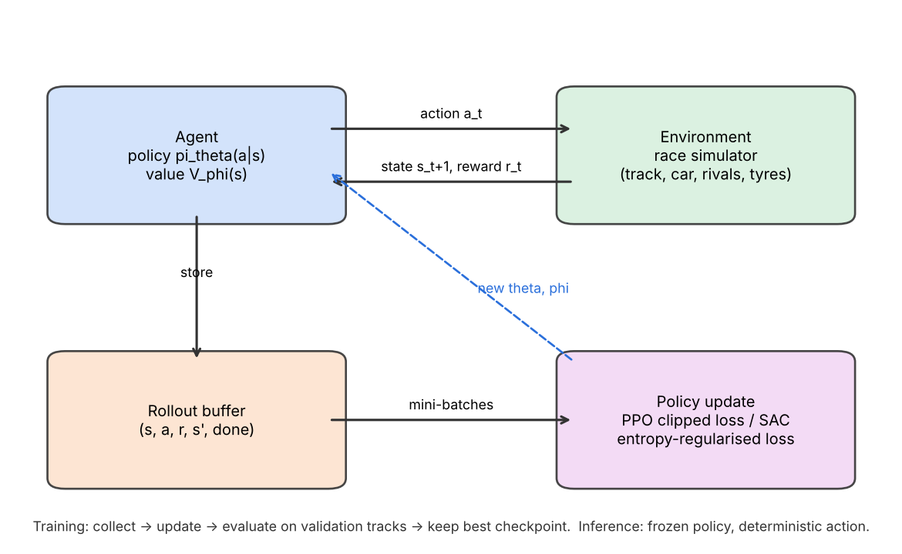{width=85%}

*Fig. 1. The RL interaction and update loop. During training the agent's actions
are sampled from the stochastic policy, transitions are stored, PPO (or SAC for the
pure-control baseline) updates the networks, and a periodic evaluation on
validation circuits keeps the best checkpoint. At inference the frozen policy acts
deterministically.*

# 2. Literature Review / Related Work

**Optimal control for racing.** The classic way to drive fast is to compute a
trajectory and track it. Liniger et al. used model predictive contouring control
to race 1:43 cars [11], and Heilmeier et al. computed minimum-curvature racing
lines and controllers for a full-size autonomous race car [12]; the TUM racetrack
database released with that work provides the circuit geometry we use. Game-
theoretic extensions add an opponent [15]. These methods give near-optimal laps
and clear guarantees, but they need an accurate model, they are expensive to solve
with interacting agents, and tactics such as a feint or a late lunge must be
hand-specified. A survey of autonomous racing summarises these trade-offs [9].

**End-to-end RL drivers.** Early work learned lane following on a real car within
a day [16], trained steering and throttle from images in a rally game [17], and
ran open competitions in the TORCS simulator [18]. Fuchs et al.
reached super-human lap times in Gran Turismo Sport with soft actor-critic [13],
and Song et al. added overtaking through a three-stage curriculum [19]. GT Sophy
[14] beat champion human drivers head-to-head; it used a distance-based passing
reward, penalties for any collision, a mix of training scenarios and a population
of opponents, trained on many consoles for days. These results show RL can find
both speed and tactics, but they rely on large compute and on high-fidelity
simulators, and their low-level policies have no explicit safety layer.

**Hierarchical and multi-agent racing.** Thakkar et al. split head-to-head racing
into a high-level discrete game planner and a low-level controller learned with
multi-agent RL, and won over 90% of races while obeying overtaking rules better
than end-to-end MARL [20]. The general idea of temporally extended actions comes
from the options framework [21] and later learned hierarchies such as option-critic
[22], FeUdal networks [23] and HIRO [24]. In our design the options are hand-built
race-craft manoeuvres and the hierarchy also spans the strategy layer.

**Safe RL and shielding.** García and Fernández surveyed ways to keep RL inside
safe states [25]; Alshiekh et al. introduced shields that override unsafe actions
of a learning agent [26]. Racing work usually relies on reward penalties instead
[14]. Our shield is predictive and symmetric: it checks a short horizon for both
cars and assumes each falls back on a rule-of-the-road manoeuvre.

**Race strategy.** Heilmeier et al. built a Monte-Carlo race simulation for circuit
motorsport [8] and a "virtual strategy engineer" whose neural networks were trained
on past decisions [10]. Thomas et al. trained an RL strategist (RSRL) for F1 and
reported an average finish of P5.33 against P5.63 for the best baseline on the
2023 Bahrain Grand Prix [27]. Fieni et al. trained multi-agent strategists with
self-play that manage energy, tyres and pit stops [28]. These works model the
driver as a fixed lap-time function; none connects the strategist to the measured
ability of a learned driver, and few test robustness to safety cars, rain and
incidents at the same time.

**Curriculum and data use.** Curriculum learning orders tasks from easy to hard
[29]; reward shaping changes the learning signal without changing the optimal
policy when it is potential-based [30]. Behaviour cloning [31] provides warm starts
but needs action labels, which public F1 data lacks.

**Summary of prior approaches.** Table 1 places the main lines of prior work side
by side. Two patterns stand out. On the driving side, the strongest learned results
[13], [14], [19] handle safety through penalties in the reward rather than through
a component that can overrule an action, and they optimise lap time or overtaking
with no strategist above them. On the strategy side, the learned strategists [10],
[27], [28] take driving performance as a given lap-time model, so whether the
driver can actually carry out the chosen plan lies outside their scope. Our system
sits between these two lines and connects them.

Table: Positioning of related work

| Work | Decision level | Method | Safety handled by | Opponents |
|---|---|---|---|---|
| Liniger et al. [11] | Driving | Model predictive contouring control | Constraints in the optimiser | Scale cars |
| Heilmeier et al. [12] | Driving | Minimum-curvature line and tracking control | Controller limits | None |
| Fuchs et al. [13] | Driving | Soft actor-critic, end to end | Reward penalties | None (time trial) |
| Song et al. [19] | Driving | Soft actor-critic with a curriculum | Reward penalties | Scripted cars |
| Wurman et al. [14] | Driving | Off-policy deep RL, scenario mix | Reward penalties | Human and AI drivers |
| Thakkar et al. [20] | Driving | Game planner over a multi-agent RL controller | Rules in the planner | Head-to-head rivals |
| Heilmeier et al. [8] | Strategy | Monte-Carlo race simulation | Not applicable | Simulated field |
| Heilmeier et al. [10] | Strategy | Neural networks trained on past decisions | Not applicable | Simulated field |
| Thomas et al. [27] | Strategy | Deep RL strategist | Not applicable | Simulated field |
| Fieni et al. [28] | Strategy | Multi-agent RL with self-play | Not applicable | Learned strategists |
| This work | Both | PPO over race-craft options; PPO strategist on a measured driver | Bilateral predictive shield | Scripted, RL-trained and frozen-self cars; rule-based field |

**Gap and positioning.** Existing work either drives one car very well without an
explicit safety guarantee, plans strategy with a fixed driver model, or needs
large compute. Our approach is different in three ways: the driver acts at the
level of manoeuvres on a planner that already laps near the limit, a shield
enforces zero contact for every car including scripted opponents, and the
strategist is trained on numbers measured from that same driver. This combination
is necessary because, as our experiments show, a flat continuous-control agent did
not reach competitive pace on our compute budget, and a strategist that assumes
better overtaking than its driver has would choose plans the driver cannot execute.

# 3. Solution Approach / Methodology

The pipeline has two learning levels that share one simulator family. At the lower
level, `RaceEnv` integrates a car in the Frenet frame of a real circuit at 50 Hz;
`TacticalEnv` wraps it so that the Driver Agent picks a manoeuvre every 0.5 s, a
`PathDriver` turns the manoeuvre into a speed and lateral-offset plan, and the
safety shield checks every car's command before the physics step. At the upper
level, `StrategyEnv` simulates a full Grand Prix lap by lap for ten cars, using a
lap-time table and pass/defend probabilities measured from the trained driver.
Both agents are trained with PPO in Stable-Baselines3, evaluated on validation
circuits during training, and scored once at the end on held-out circuits. The
novelty sits in the move-level action space, the shield, the real-start curriculum
and the measured driver profile that links the two levels.

## 3.1 Block Diagram

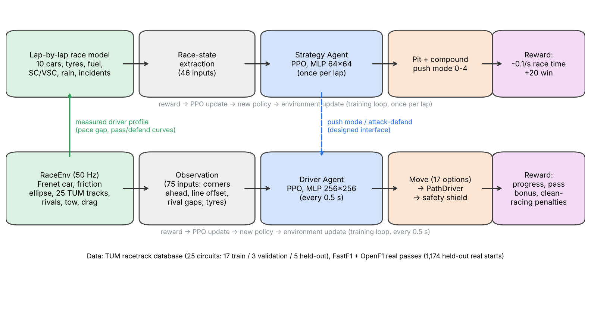{width=100%}

*Fig. 2. Environment → state extraction → agent → policy/value network → action →
environment update → reward → training loop, shown for both levels. The green
arrow is the measured driver profile that parameterises the strategy level; the
dashed blue arrow is the push-mode interface from strategist to driver (designed,
with the mode currently applied as a lap-time scaling in the strategy simulator).*

## 3.2 Environment Design

### 3.2.1 Track, car and physics

*Circuits.* Twenty-five real circuits from the TUM racetrack database [12] give
centre lines and track widths. They are split once: 17 for training, 3 for model
selection (Montreal, Hockenheim, Catalunya) and 5 for the final test only (Suzuka,
Spa, Sao Paulo, Silverstone, Yas Marina). A minimum-curvature racing line and a
g-g (friction-ellipse) lap simulation give each track's limit lap, which serves as
the pace reference.

*Car.* The car is a point mass with heading in the Frenet frame (arc length $s$,
lateral offset $n$, heading error $\psi$). Longitudinal and lateral accelerations
share one friction ellipse,
$(a_x/a_{x,\max})^2+(a_y/a_{y,\max})^2\le \mu^2$, with $a_{y,\max}=5g$, braking
$5g$, traction $1.5g$, top speed 97 m/s and an optional drag term chosen so that
full throttle exactly holds top speed. Grip $\mu$ falls with tyre wear, which grows
with tyre load and time.

*Interaction effects.* A car within a short distance behind another gets a
slipstream (12% less drag and a higher speed cap) but loses 4% grip in dirty air;
all these values are design choices labelled as such in the configuration rather
than claimed F1 figures.

*Opponents.* Scripted kinds include backmarker, slow, equal, defender, attacker
and the "guard" defenders that make one legal move to the inside before a braking
zone; RL-trained defenders and frozen copies of our own driver are also used.

*Pace reference.* Fig. 3 shows the optimal line on two held-out circuits. The model
car reaches its 5 g limits in every corner and has no load transfer, so its limit
lap is quicker than a real F1 lap (76.2 s at Suzuka). All pace results are
therefore reported as a gap to this limit lap in the same physics, never as
absolute lap times compared with real races. Table 2 lists the main constants and
marks which are reported F1 figures and which are our own design choices.

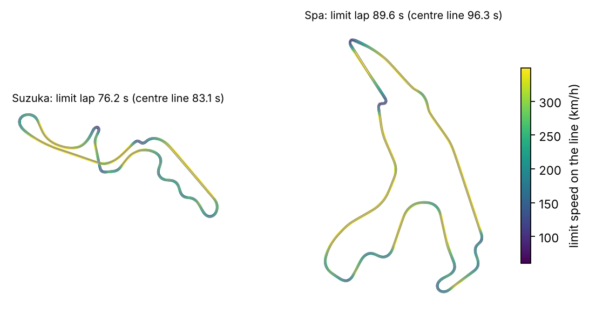{width=100%}

*Fig. 3. Minimum-curvature line on Suzuka and Spa, coloured by the limit speed the
friction ellipse allows at each point; grey lines are the track edges. In the same
physics, the optimal line is 6.9 s quicker than the centre line at Suzuka and 6.7 s
quicker at Spa.*

Table: Main simulator constants (R = reported F1 figure, D = design choice)

| Quantity | Value | Source |
|---|---|---|
| Car mass | 798 kg | R: FIA minimum weight |
| Peak lateral / braking / traction acceleration | 5 g / 5 g / 1.5 g | R: reported F1 figures |
| Top speed | 97 m/s (about 350 km/h) | R |
| Car length and width | 5.5 m and 2.0 m | D |
| Physics step / control step / move decision | 0.02 s / 0.1 s / 0.5 s | D |
| Slipstream range and drag reduction | 80 m, 12% | D |
| Dirty-air range and grip loss | 25 m, 4% | D |
| Tyre grip against wear $w$ | $1-0.10w-0.15w^6$ | D |
| Shield horizon and time step | 2.5-3.0 s, 0.05 s | D |
| Shield margins along / across the track | 1.0 m / 0.3 m | D |
| Pit-stop time loss: green / SC / VSC | 22 s / 12 s / 14 s | D |
| Race distance | fewest laps covering 305 km | R: Sporting Regulations |
| Fuel at the start | 110 kg | R: Technical Regulations |

### 3.2.2 State space

*Driver Agent (75 inputs, all scaled to roughly $[-1,1]$).* Speed, lateral offset
and heading; the corner speed limits in 12 look-ahead windows from 10 m to 250 m;
the optimal line's offset and speed ahead (reference features); tyre wear and push
level; gap, relative speed and lateral offset of the nearest car ahead and behind;
the one-hot code of the move currently running; the corner after next and the
metres left in the battle; and how the car ahead moved over the last second.

*Strategy Agent (62 inputs).* Race progress and laps left, place and gaps to the
cars around, own compound, wear and fuel, whether the two-compound rule is met,
the lap-time delta of each fresh compound against the current tyres, tyre life
left against laps to go, the pit window per compound, where a stop would rejoin,
rivals' compounds, tyre ages and last-lap pace, the track wetness and its forecast,
safety-car and VSC flags, incident flags (spun, punctured, time lost, must stop)
and the charge of the overtake-mode battery.

Table 3 breaks the final strategist's 62 inputs into groups; the earlier
dry-weather configurations used the first 46. Every input is scaled to
$[-1,1]$, and several of them are computed answers to questions a race engineer
would ask (where would a stop now rejoin, could a fresh tyre reach the flag)
rather than raw state. In early runs without these derived inputs the agent did not
discover the undercut, because the relation between a stop and the resulting
position had to be learned from the raw gaps alone.

Table: Observation of the final Strategy Agent (62 inputs)

| Group | Inputs | Count |
|---|---|---|
| Race progress | Laps done and laps left, as shares of the race | 2 |
| Position | Place; gaps to the cars ahead and behind; gap to the leader | 4 |
| Own car | Compound (one-hot); tyre wear; tyre age; fuel; stops; last lap against the reference lap | 8 |
| Rules and costs | Two-compound rule met; each compound used so far; pit loss relative to a lap | 5 |
| Nearby rivals | Tyre wear, tyre age and stops (relative to ours) of the cars ahead and behind; compound of the car ahead | 7 |
| Undercut | Place and gaps to the neighbours if we stopped this lap | 3 |
| Tyre economics | Lap time a fresh soft, medium or hard would gain; our tyre pace against the neighbours'; tyre life left against laps to go; whether each fresh compound could reach the flag | 9 |
| Incidents | Spun; punctured; time lost; stop required | 4 |
| Neutralisation | Safety car; VSC; laps neutralised so far; current pit loss | 4 |
| Weather | Wetness now; raining; forecast 3 and 6 laps ahead; on intermediates or wets; lap gain of fresh intermediates or wets; share of rivals on wet tyres; wet tyres used; wet-tyre overheating | 11 |
| Rival pace | Last lap of the cars ahead and behind, of the leader and of the field median, against ours | 4 |
| Overtake mode | Battery charge | 1 |

### 3.2.3 Action space

*Driver.* `Discrete(17)`: `line`, `outside`, `divebomb`, `dummy`, `switchback`,
`cover`, `inside`, `pull_in`, `pull_out`, and eight lane moves (`left`/`right` of
the car ahead at 3.0 m or 4.2 m centre-to-centre, each with normal or late
braking). Once chosen, a lane move runs until the other car is cleared or 30 m
behind (a committed option), which makes the problem a semi-MDP.

*Strategist.* `MultiDiscrete([6, 5, 2])`: pit choice (stay out, soft, medium,
hard, intermediate, full wet), push level (five modes from 92% to 95% of grip, with
tyre wear from 0.58× to 1.73× of normal) and overtake mode on or off. One lap in
overtake mode uses half of the battery, which recharges by a tenth per lap, and
adds 1.0 s to the car's pass advantage when attacking (0.5 s when defending). The
first action picks the starting tyre for free. The earlier dry-weather
configurations used only the first four pit choices and no overtake mode.

*Stop rules.* A few hard rules keep the strategist's choices realistic, in the same
way the shield does for the driver. No new stop is allowed within five laps of the
last one, and no stop by choice is allowed in the first quarter of the race unless
the race is neutralised, the tyres are past 70% wear, the weather changes or the
car is damaged. In the final configuration, voluntary stops in the last four laps
and wet-weather tyres on a dry track are also blocked. These last two rules were
added after training and are applied only at evaluation (Section 4.5).

### 3.2.4 Transition dynamics

The driver environment integrates all cars with a 0.02 s step; each agent decision
repeats for five physics steps (0.1 s) and a move is reconsidered every 0.5 s.
Before each step the shield simulates a 2.5-3.0 s horizon for each pair of cars and
replaces any command that cannot be followed by a safe fallback. Episodes end on
leaving the track, driving the wrong way, falling below 3 m/s, a 90 s time limit, or
at the end of a section battle.

The strategy environment advances one lap per step. Each car's lap time is the
measured lap for its grip level and fuel load, plus wear, push and dirty-air
terms, plus pit loss when stopping (22 s; 12-14 s under SC/VSC). When a quicker car
meets a slower one, a pass happens with a probability given by a logistic curve
of the pace difference, fitted to the driver's measured battles; otherwise the
quicker car follows 0.3 s behind. Rivals run seeded variants of the rule-based
plan.

### 3.2.5 Reward shaping

*Driver.* Per decision,
$$\begin{aligned}
r_t ={}& \frac{\Delta s}{d_p} - c_{\text{fail}}\,\mathbb 1[\text{off/stall}]\\
&+ B\,\big(\mathbb 1[\text{pass held}] - \mathbb 1[\text{place lost}]\big)\\
&+ w_g\,\Delta g\,\mathbb 1[\text{near}] - c_d\, n_{\text{dirty}}
- c_i\, n_{\text{shield}}\\
&- c_w(1-p)\,\Delta w \pm r_{\text{section}},
\end{aligned}$$
with progress scale $d_p=50$ m, failure penalty $c_{\text{fail}}=50$, overtake
bonus $B=100$ paid only once a new order has held for 600 m (so passing and being
re-passed earns nothing), a GT Sophy-style gap term $w_g=1$ per metre gained on a
nearby car [14], a penalty $c_d=1$ per physics step of "dirty" driving (less than
0.5 m of air side by side, chopping across a car's nose, tailgating), a penalty for
each step the shield had to intervene, a tyre-wear cost scaled by push level, and
$\pm 30$ at the end of a section battle.

*Strategist.* $r = -0.1\,(T_{\text{lap}}-T_{\text{ref}})$ per lap, summing to minus
0.1 times total race time, plus a bonus for a legal win at the flag ($+30$ in the
final configuration, $+20$ in the earlier ones) and $-50$ if the car never used two
dry compounds in a dry race.

*Design rationale.* Each driver term answers a failure we observed. The progress
term alone produced a fast but timid driver, so the pass bonus pays for the
outcome we want. A bonus paid at the moment of the pass was exploited by passing
and being re-passed, so it is paid only after the new order holds, and a lost place
costs the same amount. The gap term gives a dense signal while the car closes on a
rival, which a bonus that arrives tens of seconds later cannot. The dirty-driving
and shield penalties discourage moves that are legal only because the shield
rescues them. The strategist's race-time term is dense and equals the objective of
finishing as early as possible; the win bonus breaks ties in favour of a plan that
takes the lead, and the large rule penalty makes an illegal one-compound race never
worth it. None of these terms is potential-based [30], so each can change the optimal
policy; this is intended, because "finish early" and "finish first" are different
goals, and the bonus states which one we prefer.

### 3.2.6 Tyre, fuel and weather models

Tyre wear $w\in[0,1]$ grows with how hard the tyre is worked. In the driving
simulator the wear rate is $\dot w=u^2/L$, where $u\in[0,1]$ is the share of the
friction ellipse in use and $L$ is the tyre life, and grip scales every acceleration
limit by
$$g(w)=1-0.10\,w-0.15\,w^{6},$$
a steady fade followed by a late cliff (Fig. 4a). In the strategy simulator each dry
compound has a new-tyre grip and a life: soft 1.00 and 1,900 s, medium 0.985 and
3,000 s, hard 0.97 and 4,500 s of driving at medium push. A push level $p\in[0,1]$
multiplies wear by $3^{\,p-0.5}$, so attacking for a lap spends tyre life that must
be repaid later (Fig. 4b). These numbers are design choices that create a genuine
trade-off between a quick, short-lived compound and a slow, durable one; they were
not fitted to Pirelli data.

Fuel enters through a lap-time table. For each circuit the limit lap on the optimal
line is simulated over a grid of grip levels and fuel loads, and the strategy
simulator interpolates in this table, so a car speeds up as fuel burns off and slows
down as its tyres fade. Each car's lap is then scaled by the measured pace gap of
our driver on that circuit (Section 3.4).

Rain is a per-race wetness curve. A shower starts at a random point between 10% and
70% of the race and lasts 10-40% of it; the track wets quickly and dries slowly.
Slick grip falls linearly with wetness $\omega$ as $1-0.6\,\omega$, intermediates
peak at 0.88 at $\omega=0.45$, and full wets reach 0.82 on a soaked track
(Fig. 4c), so the crossover points lie near 30% and 70% wetness. Wet-weather tyres
overheat and wear up to four times faster as the track dries. The strategist reads
a noisy forecast of the wetness three and six laps ahead.

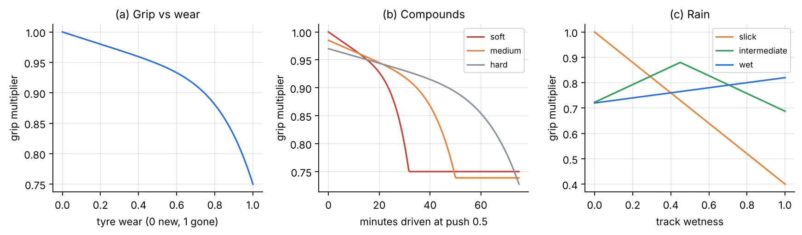{width=100%}

*Fig. 4. Tyre and weather models: (a) grip multiplier against tyre wear. (b) Grip of the three dry compounds
against minutes of driving at medium push; the flat tail is a fully worn tyre.
(c) Grip of slick, intermediate and full wet tyres against track wetness.*

### 3.2.7 Opponents, events and scenarios

Table 4 lists the other cars and the race events of the final strategy configuration. Every random draw (the circuit, the
real start, the opponent, when an event happens and how long it lasts) comes from
the environment's seeded generator. A battle or race is therefore identified by its
seed and can be replayed exactly, which is how all paired comparisons in Section 4
are made.

Table: Opponents and race events used in training and testing

| Element | Level | Behaviour |
|---|---|---|
| Backmarker, slow and equal cars | Driver | Path driver on the racing line at a fixed share of the grip |
| Scripted defender and attacker | Driver | Rule-based race craft: cover the inside, attack from the slipstream |
| Guard defenders (slow, mid, equal) | Driver | One legal move to the inside before a braking zone, then hold the line |
| RL-trained defender | Driver | PPO policy trained to defend against our attacker |
| Frozen self | Driver | A copy of our own driver used as attacker or defender |
| Rule-based rival plans | Strategy | Medium-to-hard one-stop near 45% of the race, with seeded jitter of 5% |
| Spin or puncture | Strategy | In 35% of races; a spin costs 6-15 s, a puncture 15-30 s plus a forced stop |
| Safety car / VSC | Strategy | In 30% / 15% of races; SC 2-6 laps, VSC 1-3 laps; laps 40% / 35% slower; stops cost 12 s / 14 s instead of 22 s; a second period follows in 30% of these races |
| Red flag | Strategy | In 5% of races; every car may change tyres for free; attackers gain 0.5 s at the restart |
| Rain | Strategy | In 25% of races, as described in Section 3.2.6 |

## 3.3 RL Algorithm

We use **Proximal Policy Optimization** (PPO) [32] for both agents. PPO suits the
discrete and multi-discrete action spaces, it is stable with many parallel
environments, and its on-policy updates tolerate the non-stationarity caused by
opponents and by changing scenario mixes better than replay-based methods. For the
pure continuous-control baseline we used **Soft Actor-Critic** (SAC) [33], which is
the standard choice for continuous throttle and steering [13].

PPO maximises the clipped surrogate
$$\begin{aligned}
L^{\text{CLIP}}(\theta)&=\mathbb E_t\big[\min\big(\rho_t(\theta)\hat A_t,\;
\operatorname{clip}(\rho_t(\theta),1-\epsilon,1+\epsilon)\hat A_t\big)\big],\\
\rho_t&=\frac{\pi_\theta(a_t\mid s_t)}{\pi_{\theta_{\text{old}}}(a_t\mid s_t)},
\end{aligned}$$
with advantages from generalised advantage estimation [34]
$\hat A_t=\sum_{l\ge0}(\gamma\lambda)^l\delta_{t+l}$,
$\delta_t=r_t+\gamma V_\phi(s_{t+1})-V_\phi(s_t)$. The full loss is

$$\begin{aligned}
L={}&-L^{\text{CLIP}}+c_v\,\mathbb E_t\big[(V_\phi(s_t)-\hat G_t)^2\big]\\
&-c_e\,\mathbb E_t\big[\mathcal H(\pi_\theta(\cdot\mid s_t))\big],
\end{aligned}$$

minimised with Adam for several epochs over mini-batches of each rollout; $\epsilon=0.2$.
SAC instead maximises $\mathbb E[\sum_t r_t+\alpha\mathcal H(\pi(\cdot\mid s_t))]$
with twin Q-critics, a target network updated with rate $\tau$, and an automatically
tuned temperature $\alpha$.

## 3.4 Novel Components

**Options on a planner (hierarchical action space).** Rather than learning to
steer, the driver chooses *what* to do and the `PathDriver` handles *how*: it plans
corner speeds and braking points on the path it will actually drive, so every
option is executed at the grip limit. Scripted with no sideways move, this planner
laps 24 usable circuits at +1.1% (worst +1.5%) off the limit lap.

**Bilateral predictive shield.** For each pair of cars the shield simulates the
proposed commands over the horizon and accepts them only if both cars could still
fall back on the rules of the road. Otherwise it searches candidates in order of
intrusiveness - lift before braking, then brake and/or move away - and never picks
one that leaves the road unless nothing else is clear. Four successive fixes were
needed: treating the fallback itself as a candidate, preventing brake-tests,
rejecting off-road swerves beside a car, and widening steering authority and
horizon.

The procedure applied at every 0.1 s control step is summarised in Algorithm 2. Its
key property is that the fallback it assumes is itself always one of the
candidates, so a command judged safe now still leaves a safe command at the next
step; this is what turns a local check into a guarantee over the whole battle,
provided both cars are filtered.

```
Algorithm 2: Bilateral predictive safety shield for one pair of cars
Input: states x_A (car behind) and x_B (car ahead); proposed commands u_A, u_B
1:  H <- look-ahead of 2.5 s, extended up to 3.0 s when the cars close quickly
2:  function SAFE(x_A, u_A, x_B, u_B):
3:     integrate both cars over H: hold the commands for one decision,
        then apply the fallback (A brakes hard, B keeps its lane and pace)
4:     return the cars never come within one car length + 1.0 m along
        and one car width + 0.3 m across the track
5:  for the car behind first, then the car ahead (against A's final command):
6:     if SAFE(proposed command): keep it              # clean racing is untouched
7:     else try candidates in order of intrusiveness:
          car behind:          brake; brake and steer away; the fallback
          car beside or ahead: steer away; steer away and brake;
                               if it was braking, brake less (no brake-test)
8:        use the first candidate that is SAFE and stays on the road
9:     if none is SAFE: use the on-road candidate with the most room;
        leave the road only if that gives strictly more room
```

**Real-start curriculum.** About 1,200 real passes and defences (FastF1 for 2021-
2022, OpenF1 for 2023 onwards) are converted to start states 400 m before the real
pass location; 40% of training episodes begin from one. The held-out circuits'
real starts form the final test.

**Behaviour-cloned warm start.** Before PPO, the driver is trained by supervised
learning to copy the scripted tactician's choices (60k decisions, 95.9% agreement
in one run; 40k defence decisions at 91.1% in the defend run), so exploration starts
from competent play.

**Driver profile and stay-out prior.** The trained driver is measured on all 25
circuits (225 solo laps and 1,512 one-lap battles) to fit its pace gap and logistic
pass and defend curves; the strategy simulator uses these numbers. When the win
reward is sparse, the pit head's "stay out" logit is raised by 5 at initialisation.

The pass curves have the logistic form
$$P(\text{pass}\mid\Delta)=\frac{1}{1+\exp\!\big(-(\Delta-\delta)/\sigma\big)},$$
where $\Delta$ is the attacker's pace advantage in seconds per lap. For our driver
attacking, the fit over 648 battles gives $\delta=4.9$ s and $\sigma=1.71$ s; for
rivals attacking our driver, 864 battles give $\delta=1.0$ s and $\sigma=1.15$ s
(Fig. 5). The asymmetry is itself a finding: the learned driver defends well, but it
needs almost five seconds a lap of extra pace for an even chance of passing within
a lap. A strategist trained on this profile therefore learns to gain places in the
pit lane rather than on track. The main strategy scenarios add an attack-skill
offset of 3.4 s, which models a stronger overtaker; the measured curve itself is
kept unchanged.

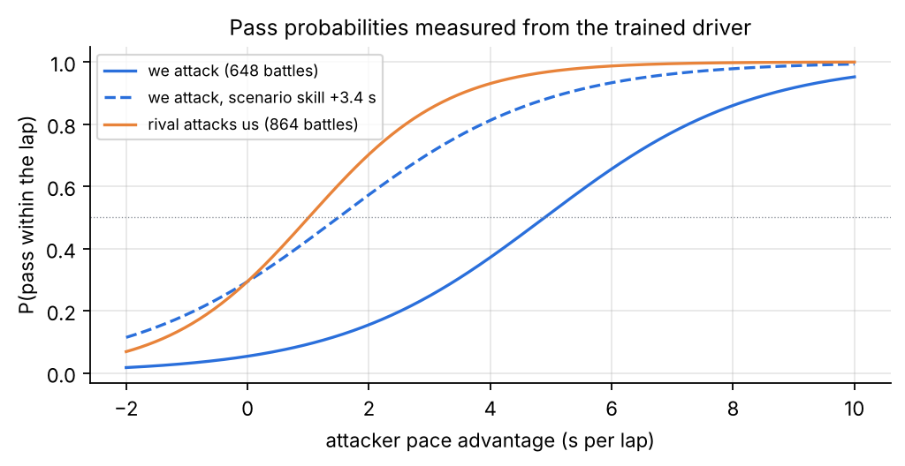{width=90%}

*Fig. 5. Probability of a pass within one lap against the attacker's pace
advantage, fitted to battles of the trained driver on all 25 circuits. Solid blue:
our driver attacking; orange: rivals attacking our driver; dashed: the attack curve
with the 3.4 s skill offset used in the main strategy scenarios.*

## 3.5 Algorithm Description

```
Algorithm 1: Hierarchical training of the Driver and Strategy Agents
Input: circuits split C_train / C_val / C_test; real-start library D; seeds
1:  // ---------- Driver level ----------
2:  init policy pi_theta, value V_phi (MLP 256x256); set seed
3:  pi_theta <- behaviour-clone(scripted tactician on C_train)        # warm start
4:  repeat until N_driver decisions:
5:     for each of K parallel envs:
6:        reset: pick circuit c ~ C_train; with prob 0.4 start from d ~ D(c),
                 else random section battle vs opponent from the mix
7:        observe s_t (75 features)
8:        a_t ~ pi_theta(.|s_t)                                      # move choice
9:        for each 0.1 s sub-step of the 0.5 s decision:
10:          u_i <- PathDriver(move_i) for every car i
11:          u_i <- Shield(u_i, others)                              # zero-contact filter
12:          integrate physics (dt = 0.02 s)
13:       r_t <- progress + held-pass bonus + gap term - dirty - shield - wear
14:       store (s_t, a_t, r_t, s_{t+1}, done)
15:    compute GAE advantages; for E epochs over mini-batches: Adam step on PPO loss
16:    every M decisions: evaluate on C_val; keep checkpoint if best and contact-free
17:  measure driver on all circuits -> profile P (pace gap, pass/defend logistic fits)
18: // ---------- Strategy level ----------
19:  init pi_psi (MLP 64x64); add stay-out prior to pit logits
20:  repeat until N_strategy laps:
21:     reset race: circuit ~ C_train, grid slot, rivals' plans, random SC/VSC/
                 spin/puncture/rain draws (seeded)
22:     each lap: observe race state (62 features); (pit, push, overtake) ~ pi_psi
         a stop that breaks the stop rules becomes stay out
23:        simulate one lap for 10 cars using P; r <- -0.1 * lap time delta
24:     at the flag: r += 30 * win - 50 * illegal
25:     PPO update as in lines 15-16, selecting checkpoints by validation wins
26: return pi_theta*, pi_psi*
Stopping: fixed decision/lap budget; best checkpoint chosen on C_val only;
          C_test is touched once, at the end.
```

## 3.6 Evaluation Protocol

Four rules govern every number reported in Section 4.

*Data separation.* The 25 circuits are split once into 17 training, 3 validation and
5 held-out circuits. Training episodes use only training circuits, checkpoints are
chosen on validation circuits, and held-out circuits are evaluated once after
training ends, with no further tuning. The same split applies to the real-start
library, so no real situation from a held-out circuit is seen during training.

*Paired, seeded comparisons.* A baseline and a learned policy always run on the same
seeded episodes (same circuit, grid, rival plans and event draws), so a difference
in outcome comes from the decisions alone. Held-out strategy scorecards use 200
races per case (seeds 70,000 to 70,199, circuits in rotation, 40 per circuit);
driver scorecards use every real start or battle in the held-out set.

*Strict success rules.* A pass counts only if our car is ahead at the end, the new
order has held for 600 m (1 km in the strict re-scoring), and there was no contact,
no wheel off the track and no dirty-driving step. A defence counts only if the car
is still ahead and drove cleanly. A race win counts only if the car used two dry
compounds.

*Statistics.* For the three-seed study we report the mean, the sample standard
deviation $\hat\sigma$ and a 95% confidence interval from the t-distribution with
two degrees of freedom, $\pm 4.30\,\hat\sigma/\sqrt 3$. For single runs we give the
count and the number of trials, so a binomial interval can be computed.

# 4. Experimental Results

## 4.1 Experimental Setup

**Data.** No offline RL dataset is used. Circuit geometry comes from the TUM
racetrack database (25 circuits, pinned commit). Real overtaking situations come
from FastF1 timing for 2021-2022 and from the OpenF1 API for 2023-2025; 2018-2020
were skipped because they now require a paid login. The held-out library contains
1,174 real starts on the five test circuits.

**Environment.** As in Section 3.2. Driver: 50 Hz physics, 10 Hz control, a move
decision every 0.5 s, 90 s battles or 600-800 m sections spanning two corners.
Strategy: full Grand Prix length (fewest laps covering 305 km), ten cars, our car
starting tenth.

**Hardware.** All driver training ran on a laptop CPU (AMD Ryzen 7 7840HS, 8 cores
/ 16 threads, no GPU). Strategy runs ran on that laptop or on a 4-vCPU cloud
container, also without a GPU.

**Software.** Python 3.12, Gymnasium [35], Stable-Baselines3 2.9 [36], PyTorch
2.14, NumPy, FastF1 3.8 and the OpenF1 REST API, with `uv` for reproducible
environments. Every run writes its resolved configuration, seed and git commit next
to its checkpoints.

**Software practice.** The physics, tyre, race and shield models are pure
functions (state in, state out) with unit tests; the repository has 342 tests,
plus type checking and linting, all run before every merge. Every environment,
training run and evaluation takes an explicit seed, and no part of the simulator
draws unseeded random numbers. Hyperparameters and reward weights live in one YAML
file per experiment, and each run stores its resolved configuration, seed and git
commit with its checkpoints, so any number in this report can be traced to the code
and settings that produced it.

**Development stages.** The system was built in stages, each kept only once it ran
and passed its tests (Table 5). The order matters for interpreting the results: the
driver's action space was redesigned after the end-to-end SAC stage failed to reach
competitive pace, and the strategist was started only after the driver could
overtake and defend cleanly.

Table: Development stages and what each changed

| Stage | What was built | Outcome |
|---|---|---|
| Simulator | Segment track, point-mass car, first Gymnasium environment | Physics as tested pure functions |
| Rule-based driver | Baseline driver and lap analytics | 2.3-3.0% off the limit lap |
| First PPO driver | Throttle and steering on synthetic and six real circuits | Clean laps, 1-4% behind the baseline |
| Real circuits and SAC | 25 TUM circuits, Frenet car, optimal line, SAC driver | Plateau 17-20% off the limit lap |
| Move-level driver | Path planner, race-craft moves, PPO picks moves | Planner at +1.1%; overtaking and defending possible |
| Real starts and shield | FastF1/OpenF1 starts, predictive shield | 0 contacts on 1,174 held-out real situations |
| Passing physics | Slipstream, drag, shield in the tow | Scripted passes from 8 to 25 of 36 |
| Section battles | Corner-by-corner battles, strict clean-racing rules | Learned driver level with the scripted tactician |
| Sparring partners | Guard defenders and an RL-trained defender | 0 contacts in 480 guard battles |
| Defend run | Main driver also trained to defend | Held-out defences 273 vs 264, passes 49 vs 29 |
| Strategy Agent | Lap-by-lap race model, PPO on the measured driver | 72% wins vs 10%; rain 68% vs 0% |
| Every race case | Fast car from tenth, spins, punctures, SC/VSC | 96.7% clean wins vs 91% (three seeds); safety-car weakness found |
| One agent for all cases | Stop rules, red flags, two SC periods, rain, rival pace, overtake mode | Wins or ties the plan in 7 of 8 cases; rain 89.5% vs 66.5% |

**Hyperparameters.**

Table: Training hyperparameters of the four learning set-ups

| Setting | SAC driver (baseline) | PPO driver (defend run 2) | PPO driver (real starts) | PPO strategist |
|---|---|---|---|---|
| Learning rate | 3e-4 → 3e-5 (linear) | 1e-4 | 3e-4 | 3e-4 |
| Discount $\gamma$ | 0.995 | 0.97 | 0.99 | 0.995 |
| GAE $\lambda$ / SAC $\tau$ | $\tau$ = 0.005 | 0.95 | 0.95 | 0.95 |
| Batch size | 256 | 256 | 512 | 256 |
| Rollout / buffer | 1M replay | 128 steps × 12 envs | 256 × 8 envs | 512 × 4 envs |
| Epochs per update | 4 gradient steps / vec-step | 8 | 6 | 10 |
| Exploration | auto entropy temperature | entropy coef. 0.01 + BC warm start | entropy coef. 0.03 + BC | entropy coef. 0.01 + stay-out prior |
| Network | 256×256 ReLU | 256×256 ReLU | 256×256 ReLU | 64×64 tanh (SB3 default) |
| Training budget | 2.0M decisions | 0.5M decisions | 1.5M decisions | 1-4M laps (≈17k-67k races) |

**Effect of each setting (observed in our runs).**

* *Discount factor.* In an early lap-time driver, $\gamma=0.98$ (a 5 s horizon at
  10 Hz) learned to stop before a chicane because it could not see the value of the
  rest of the lap; $\gamma=0.995$ fixed this. For the move-level driver, whose
  decisions last 0.5 s or a whole manoeuvre, 0.97-0.99 was enough.
* *Control rate.* At 50 Hz the early driver never discovered braking; 10 Hz worked;
  a 25 Hz SAC variant completed no lap after 250k decisions.
* *Reward scale and learning rate.* Multiplying all driver rewards by 10 sped up
  early SAC learning (+18% off the limit at 300k vs +26%), but linear learning-rate
  decay did not remove the final plateau. A smaller PPO learning rate (1e-4) in the
  defend run kept the attacking skill from being overwritten.
* *Entropy and exploration.* After behaviour cloning, entropy collapsed and the
  driver stopped attempting passes; raising the entropy coefficient from 0.01 to
  0.03 together with a larger pass bonus restored them (Section 4.5). In self-play
  pilots the policy entropy still collapsed to about 0.3 nats.
* *Batch size and epochs.* Not swept systematically; values follow common PPO
  defaults scaled to the number of environments.
* *Seeds.* All earlier runs used seed 0. To measure seed sensitivity we retrained
  the main strategy configuration with three seeds (Section 4.2.5).

## 4.2 Performance Evaluation

### 4.2.1 Mean evaluation return and learning curves

Because the reward weights differ between runs, we report the task-level quantity
each evaluation measured rather than raw return: lap-time gap for pure driving,
success rate for battles, and win rate for strategy.

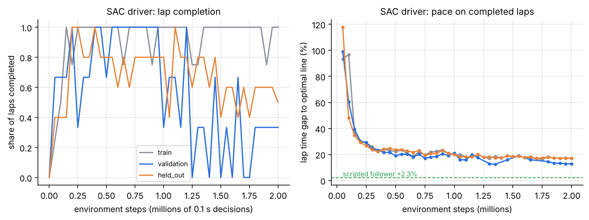{width=100%}

*Fig. 6. Pure-RL SAC driver (seed 0). Left: share of evaluation laps completed;
right: mean gap to the optimal-line lap on completed laps. Pace improves quickly
from +100% to about +25% within 0.3M decisions, then flattens at +13% to +20%; the
scripted planner sits at +2.3%.*

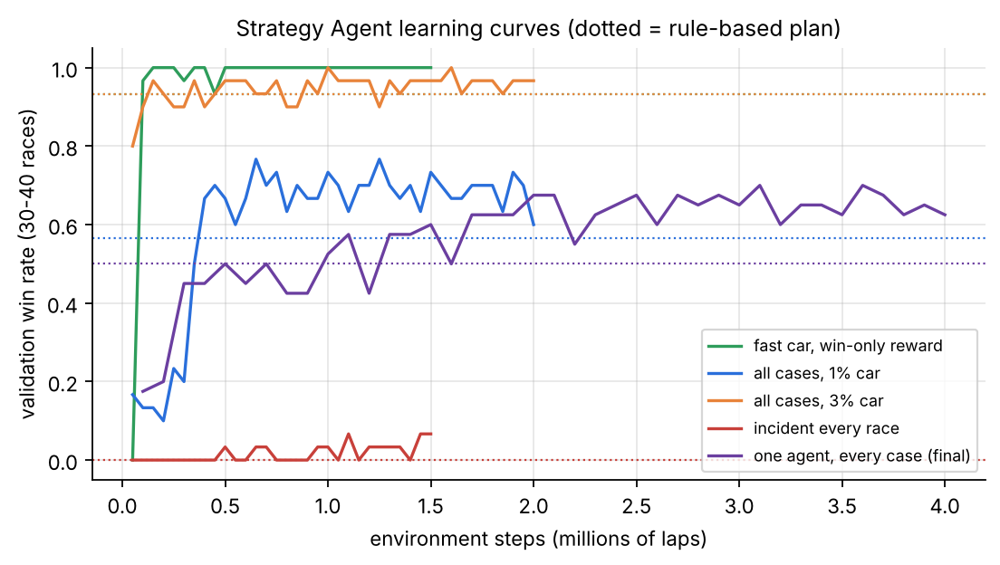{width=90%}

*Fig. 7. Strategy Agent validation win rate for five scenario configurations (30
races per point; 40 for the final one-agent configuration, which mixes every race
case). Dotted lines are the rule-based plan on the same races.*

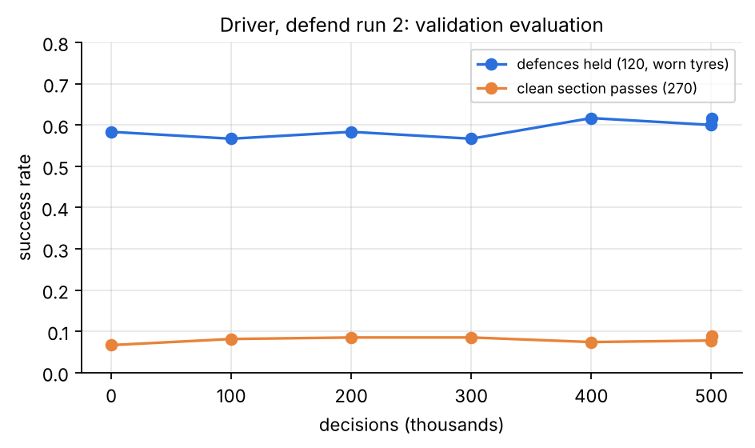{width=70%}

*Fig. 8. Driver defend run 2: validation defences held (120, worn tyres) and clean
section passes (270) over 0.5M decisions. Both curves are nearly flat: the
behaviour-cloned start already sits close to what these moves allow.*

### 4.2.2 Success rate

Success is defined per task. A *pass* succeeds when our car is ahead at the end of
the battle, the new order has held for 600 m (1 km in later re-scoring), and there
was no contact, no off-track and no dirty step. A *defence* succeeds when the car is
still ahead and clean. A *race* succeeds when the car wins legally.

Table: Success rates on the held-out circuits

| Task (held-out circuits) | Proposed | Best baseline |
|---|---|---|
| Defences held, worn tyres (460) | **273 (59.3%)** | 264 (57.4%) line-holding |
| Clean section passes vs slow + guard cars (350) | **49 (14.0%)** | 29 (8.3%) starting policy |
| Attack vs equal-pace defender, real starts (495)* | 434 (87.7%) | 168 (33.9%) scripted tactician |
| Race wins, clean, 1% faster car (200, final agent) | **100%** | 99% rule-based plan |
| Race wins after a spin (200) | **38.5%** | 13.0% |
| Race wins, safety car (200) | **95.5%** | 93.5% |
| Race wins in the rain (200) | **89.5%** | 66.5% |

\*Later found to be inflated by place-swapping; see Section 4.3.

The strategy rows above are from the final Strategy Agent (`strategy_master`), a
single agent trained once (seed 0, 4M laps) on a mix of every race case and scored
on 200 held-out races per case with the stop rules of Section 3.2.3 switched on.
Table 8 gives its full scorecard. It wins at least as often as the rule-based plan
in seven of the eight cases and finishes each case on average sooner; the
exception is the VSC, where it wins 91% against 96%.

Table: Final Strategy Agent on held-out races, by case (agent / rule-based; 200 races per case)

| Case | Wins | Mean place | Stops per race | Race time vs plan |
|---|---|---|---|---|
| Clean | **100%** / 99.0% | 1.00 / 1.01 | 1.37 / 1.00 | -6.6 s |
| After a spin | **38.5%** / 13.0% | 3.42 / 5.24 | 1.52 / 1.00 | -4.1 s |
| After a puncture | **5.5%** / 0.5% | 8.06 / 9.70 | 1.92 / 1.64 | -10.7 s |
| Safety car | **95.5%** / 93.5% | 1.16 / 1.08 | 1.53 / 1.00 | -6.7 s |
| Two safety cars | **94.5%** / 93.0% | 1.14 / 1.15 | 1.77 / 1.00 | -7.3 s |
| VSC | 91.0% / **96.0%** | 1.45 / 1.04 | 1.41 / 1.00 | -3.5 s |
| Red flag | **98.0%** / 97.5% | 1.08 / 1.02 | 1.73 / 1.60 | -8.2 s |
| Rain | **89.5%** / 66.5% | 1.58 / 2.56 | 2.56 / 3.07 | -15.0 s |

### 4.2.3 Cumulative regret

We define regret against the best available reference policy.

*Driving (cost minimisation).* Per lap, $\text{regret}=T_\pi-T_{\text{opt}}$, the time
lost to the optimal-line limit lap in the same physics. Summed over the four
held-out circuits that the SAC agent finished, cumulative regret is 57.9 s for SAC,
46.5 s for the v1 cautious baseline, and 6.8 s for the scripted path follower; Yas
Marina is excluded because SAC did not finish it (scripted: 2.5 s there).

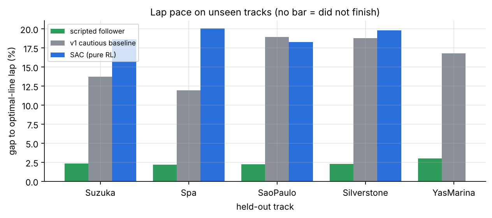{width=85%}

*Fig. 9. Gap to the optimal lap on each held-out circuit.*

*Strategy (reward maximisation).* Per race, place regret is $\text{place}-1$
(distance from the best possible result). In the fastest-car, win-only scenario the
agent's cumulative place regret over 200 held-out races is 0 (200/200 wins) against
22 for the rule-based plan (mean place 1.11). For race time we define regret per
race as the time lost to the faster of the two policies on that seeded race. Over
200 clean held-out races the three seeds accumulate 44 s, 173 s and 26 s of
race-time regret, against 1,125 s for the rule-based plan (measured against seed
2): the agent is the faster policy in almost every race. For the final agent we
logged only per-case means: over its 1,600 held-out races (200 in each of the eight
cases) it finishes 12,434 s sooner than the rule-based plan in total, 7.8 s per
race on average, and its mean race time is lower in every case (Table 8).

### 4.2.4 Convergence speed and sample efficiency

We measure the number of environment steps until the validation win rate first
exceeds the rule-based plan's, and until it reaches 90% of its own best.

Table: Convergence speed and sample efficiency of the Strategy Agent (validation)

| Strategy configuration | Baseline win rate | Steps to beat baseline | Steps to 90% of best | Best win rate |
|---|---|---|---|---|
| Fast car, win-only reward | 93% | 100k laps (≈1.7k races) | 100k | 100% |
| All cases, 3% faster car | 93% | 150k | 100k | 100% |
| All cases, 1% faster car | 57% | 400k (≈6.7k races) | 450k | 77% |
| Incident every race (wins) | 0% | 500k | 1.1M | 7% |
| One agent, every case (final) | 50% | 1.0M (≈17k races) | 2.0M | 70% |

The final configuration needs more experience than the others because it mixes
eight race cases, rain and two extra actions (wet tyres and overtake mode) into one
policy: it first beats the plan on validation after 1.0M laps and reaches 90% of
its best win rate after 2.0M. The driver is far less sample-efficient: SAC needed about 0.3M decisions (8 h of
simulated driving) just to finish laps reliably, and never matched the scripted
planner within 2M decisions. The move-level PPO driver starts from a
behaviour-cloned policy, so its first evaluation is already competent; the real-
start run reached its attack plateau within 0.2M decisions (Fig. 12).

### 4.2.5 Stability across seeds

Before the final configuration existed, we retrained the earlier all-cases
configuration (`strategy_all.yaml`: 1% faster car, races with spins, punctures, SC
and VSC) with three seeds (0, 1, 2) for 1M laps
each, using identical code, and scored each seed's best checkpoint on the same
200 held-out races per case. These runs use the current configuration, which
includes the minimum-stint rule (no new stop within five laps of the last).

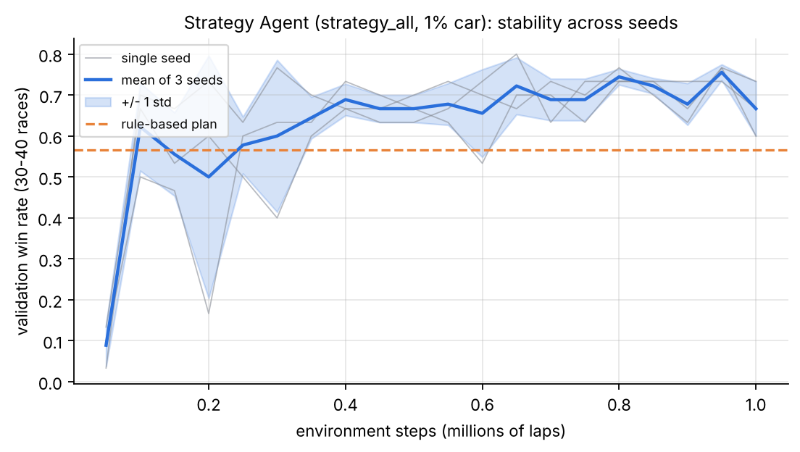{width=85%}

*Fig. 10. Validation win rate for three seeds: individual runs (grey), mean (blue)
and one standard deviation (band). All three seeds pass the rule-based plan's 57%
within 0.1-0.25M laps and settle at 60-80%.*

Table: Stability across three seeds (held-out circuits, 200 races per case)

| Held-out case (200 races) | Seed 0 | Seed 1 | Seed 2 | Mean ± s.d. | 95% CI | Rule-based |
|---|---|---|---|---|---|---|
| Clean race wins | 97.0% | 95.0% | 98.0% | 96.7 ± 1.5% | ±3.8 | 91.0% |
| After a spin | 33.5% | 25.5% | 30.5% | 29.8 ± 4.0% | ±10.0 | 4.5% |
| After a puncture | 0% | 0% | 0% | 0% | - | 0% |
| Safety car | 81.0% | 78.0% | 75.0% | 78.0 ± 3.0% | ±7.5 | 89.5% |
| VSC | 93.5% | 82.5% | 86.0% | 87.3 ± 5.6% | ±14.0 | 89.0% |
| Mean race time vs rule-based, clean | -5.0 s | -3.4 s | -5.5 s | -4.6 ± 1.1 s | | 0 |

Steps to first beat the rule-based plan on validation: 100k, 250k and 100k laps;
best validation win rate 77%, 77% and 80%. The clean-race and after-spin
advantages hold for every seed and their confidence intervals exclude the
baseline. The safety-car result does not: every seed wins fewer SC races than the
rule-based plan (78% vs 89.5%), although its mean race time is still 0.5-1.4 s
shorter. The agent optimises race time, not position, and under the minimum-stint
rule it makes extra stops under the safety car (1.4-1.6 stops against 1.0) that
save time on average but sometimes cost the lead. The earlier single-seed agent
trained without the minimum-stint rule won 94.5% of SC races, so this rule and the
time-based reward interact; a position-aware term under neutralised running is the
obvious fix. Seed 1 is the weakest in every case, which shows why a single seed
should not be reported alone.

This study directly shaped the final configuration. To stop the agent from trading
track position for small time gains, the final configuration forbids stops by
choice in the first quarter of the race unless they are cheap or needed, models
longer and repeated safety-car periods and red flags so that the agent sees many
more of them, and raises the win bonus from 20 to 30. Under these settings the
final agent wins 95.5% of safety-car races against 93.5% for the plan and 94.5%
against 93% with two safety-car periods (Table 8). The final agent was trained
with one seed only; repeating the three-seed study for it is the first item of
future work.

### 4.2.6 Computational efficiency

Table: Computational cost

| Item | Value |
|---|---|
| SAC driver training (2.0M decisions) | 3 h 29 min, laptop CPU, ≈165 decisions/s shared |
| PPO real-start driver (1.5M decisions) | 3 h 31 min, ≈117 decisions/s with the shield on |
| PPO defend run 2 (0.5M decisions) | 1 h 19 min, ≈104 decisions/s |
| PPO strategist (2M laps) | 1M laps in about 15 min per run (three runs sharing 4 vCPUs, one thread each); ≈1.1k laps/s |
| Safety shield cost | ≈35% lower environment throughput |
| Parameters | driver 175,122; strategist 14,986 (46 inputs) and 17,294 (final, 62 inputs) |
| Inference latency (CPU, batch 1) | driver 0.06 ms per decision; strategist 0.15 ms (46 inputs) and 0.21 ms (final) per decision (policy only) |
| Total logged training time | > 20 h CPU across all runs; no GPU used |

A strategy training run used about 0.8 GB of resident memory in its main process; memory of the driver runs and energy use were not measured.

### 4.2.7 Problem-specific metrics

For racing we report: **gap to optimal lap (%)**, **contacts**, **off-tracks**,
**dirty steps** (unsafe proximity), **shield interventions**, **clean passes held**,
**defences held**, and **tyre wear per lap**. For strategy: **win rate**,
**podium rate**, **mean finishing place**, **race time**, **legality** (two-compound
rule), **stops per race**, **undercuts made and suffered**, and **on-track passes per
race**. Generalisation is always reported on the five unseen circuits; robustness
to opponents is reported against scripted, RL-trained and frozen-self opponents.

For the earlier all-cases configuration, whose three seeds give per-race data,
Table 12 gives the strategy metrics behind the win rates of Section 4.2.5, and
Table 13 splits the wins by circuit. Three patterns stand out. First, the agent's
clean-race gain comes from the circuits where the rule-based plan sometimes loses
(Suzuka, Silverstone, Yas Marina); where the plan already wins every race (Sao
Paulo) there is nothing to gain. Second, recovery after a spin varies widely by
circuit, from 4% at Suzuka to 63% at Sao Paulo. A spin costs a similar number of
seconds everywhere, but on Sao Paulo's short lap there are more laps left in which
to recover it, which is the likely reason. Third, the safety-car weakness is
concentrated at Suzuka and Spa, and it shows up in the stop count: the agent makes
about 1.5 stops per safety-car race against exactly one for the plan.

Table: Earlier all-cases configuration: race statistics on held-out circuits (agent mean of three seeds / rule-based; 200 races per case)

| Case | Wins | Podiums | Mean place | Stops per race |
|---|---|---|---|---|
| Clean | 96.7% / 91.0% | 98.3% / 99.0% | 1.16 / 1.14 | 1.01 / 1.00 |
| After a spin | 29.8% / 4.5% | 45.8% / 21.0% | 5.18 / 6.64 | 1.42 / 1.00 |
| After a puncture | 0% / 0% | 1.2% / 0% | 9.55 / 9.94 | 2.01 / 1.65 |
| Safety car | 78.0% / 89.5% | 87.2% / 97.0% | 1.88 / 1.19 | 1.53 / 1.00 |
| VSC | 87.3% / 89.0% | 92.2% / 98.0% | 1.60 / 1.19 | 1.06 / 1.00 |

Table: Earlier all-cases configuration: held-out win rate (%) by circuit (agent mean of three seeds / rule-based; 40 races per circuit and case)

| Circuit | Clean | After a spin | Safety car | VSC |
|---|---|---|---|---|
| Suzuka | 94.2 / 82.5 | 4.2 / 0.0 | 62.5 / 82.5 | 79.2 / 82.5 |
| Spa | 93.3 / 92.5 | 17.5 / 2.5 | 70.8 / 82.5 | 77.5 / 87.5 |
| Sao Paulo | 100.0 / 100.0 | 63.3 / 17.5 | 95.8 / 97.5 | 98.3 / 100.0 |
| Silverstone | 96.7 / 87.5 | 24.2 / 2.5 | 80.8 / 90.0 | 89.2 / 87.5 |
| Yas Marina | 99.2 / 92.5 | 40.0 / 0.0 | 80.0 / 95.0 | 92.5 / 87.5 |

## 4.3 Results and Discussion

**Result 1 - pure end-to-end RL plateaued.** *What happened:* every SAC recipe
(different look-ahead, reward scales, control rates, demonstrations, optimal-line
features) plateaued at 17-20% slower than the limit lap; the best checkpoint
finished four of five held-out circuits at +19.2%. *Why:* the agent found a
cautious optimum - it failed only 2-5% of training episodes but averaged about
60 m/s against 70 m/s on the optimal line; one off-track costs 50 reward units,
more than the time gained by braking later in many corners. *Expected?* Partly;
published superhuman SAC drivers trained for far longer on richer signals [13].
*Stability:* completion on validation swung between 0/3 and 3/3 at the same average
pace, so checkpoint selection was partly luck. *Unseen tracks:* held-out pace
matched training pace, so the plateau was not over-fitting. This result motivated
the move-level design.

**Result 2 - the shield removed contacts at small cost.** With the scripted
tactician on 424 held-out real starts, contacts fell from 20 to 0; off-tracks rose
from 18 to 30 because the shield's swerves left the planner less margin, which later
fixes reduced to zero on 284 validation starts with random moves. Every trained
driver since then recorded zero contacts on held-out circuits except two, both
caused by a scripted attacker at the same Silverstone corner. *Component:* the
symmetric fallback check; reward penalties alone had left 1-4 contacts per
evaluation.

**Result 3 - reward exploitation in attacking, and its fix.** With an overtake
bonus of 100 the real-start driver beat the scripted tactician by a wide margin
(434/495 vs 168/495 attacks). Watching replays revealed that the agent swapped
places back and forth: it was paid for a pass that did not last. When passes had to
hold 1 km over 150 s battles, the same model succeeded in only 7 of 49 attacks. We
then (a) paid the bonus only once a new order held for 600 m and charged equally
for re-passes, (b) added dirty-driving penalties, and (c) scored battles strictly.
Under these rules the learned driver roughly matches but does not beat the scripted
tactician on attacks (56 vs 65 of 525 held-out battles), while the defend-trained
driver improves both defence (273 vs 264) and attack (49 vs 29 of 350). *Where it
failed:* a brute-force oracle over the same moves found only 38 of 180 validation
battles winnable within one section, so the ceiling, not the learner, limits
overtaking at small pace gaps.

**Result 4 - the strategist learned undercuts and event responses.** Trained
against rivals that all run the rule-based plan, the agent discovered a race-long
undercut: a medium-to-hard stop at 36-42% of the race, earlier than every rival, then
inheriting the lead as they stop later on older tyres. With our measured driver
(which needs a large pace edge to pass) it won 72% of held-out races against 10% for
the rule-based plan, and finished on the podium in 95% against 33%. In the rain it
pitted about a lap earlier than rivals by reading the forecast (68% wins against
0%). After a spin it pits next lap for fresh tyres and attacks (29% wins vs 4.5%).
*Which component:* the race-state features (tyre delta, pit window, rejoin
position) and the race-time reward; the win-only reward did not learn without the
stay-out prior. *Where it failed:* a puncture costs 40-50 s, which a 0.3 s/lap edge
cannot recover (0% for both policies); VSC wins were level (88.5% vs 89%).

**Result 4b - one agent for every case.** The final agent handles all eight cases
with one policy (Table 8, Fig. 13). In the rain it gains most: 89.5% wins against
66.5%, with fewer stops (2.56 against 3.07); unlike the plan, it can read the
wetness forecast and the share of rivals already on wet tyres (Table 3). On Suzuka
alone, 100 extra rain races (seeds 80,000 to 80,099) give 87% wins against 63%.
After a spin it wins 38.5% against 13%, stopping more often than the plan (1.52
against 1.00 stops per race) to recover on fresh tyres. *Where it failed:* after a puncture it still
wins only 5.5% of races, because the puncture costs more time than a 1% faster car
can recover; under the VSC it often takes the cheaper stop and then loses time
passing cars on track, and wins 91% against 96%. The last checkpoint of training
was better after a spin (48% wins) but worse in the other cases, so selecting the
checkpoint on validation wins mattered (Table 16).

**Result 5 - generalisation.** Every number above is on circuits never used for
training or model selection. Strategy performance on held-out circuits was lower
than on validation in the first pilot (place 4.20 vs 2.75), and similar in later
runs; driver results transferred with no visible gap.

**Result 6 - one race in detail.** Fig. 11 follows a single held-out race at
Suzuka (the first race of the safety-car scorecard). Panel (a) runs it with the
same seed for the rule-based plan and for the seed-0 agent of the earlier
configuration. Both start tenth on mediums and both stop
for hards on lap 25. The agent drives most of its first stint at a lower push level
(0.25 against 0.5), so its tyres are less worn at the stop (wear 0.44 against 0.58
on lap 20). When the safety car comes out on lap 35 the agent is third. It makes a
second, cheaper stop on lap 36 for new hards and rejoins tenth, because under the
safety car the field runs nose to tail and even a cheap stop costs every place. The
rule-based plan stays out, moves up as the remaining rivals stop, leads from lap 42
and wins. With fresh tyres the agent climbs back to fifth but runs out of laps, and
its race time is 7.1 s longer. This race shows the safety-car weakness of
Section 4.2.5 in concrete form: the stop is cheap in seconds, but the lost track
position cannot be recovered with the driver's measured overtaking ability
(Fig. 5).

Panel (b) runs the same seed under the final configuration, whose safety car falls
later (laps 41-45). The final agent starts on softs, conserves them for the first
laps, leads from lap 16 and then pushes to build a gap. It stops for mediums on
lap 23 (two laps before the plan) and leads again by lap 27. When the safety car
comes out it is far enough ahead that a cheap stop for new mediums costs only one
place; it retakes the lead on the second lap after the restart and wins, finishing
3.3 s sooner than the plan. The difference from panel (a) is not a cheaper stop
but the larger gap before it, which the agent built with a quicker first compound
and an earlier stop.

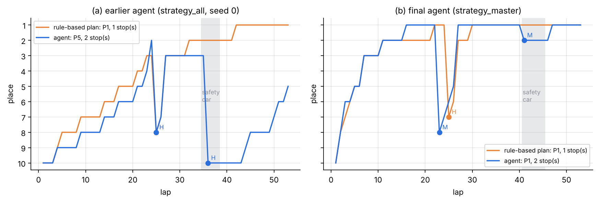{width=100%}

*Fig. 11. Place per lap in one seeded held-out race at Suzuka with a safety car
(grey band): (a) the earlier agent, (b) the final agent, each against the rule-based
plan on the same seed under its own configuration. Dots mark pit stops and the
letter the new compound.*

## 4.4 Comparison with Existing / Benchmark Methods

*Driver.*

Table: Driver Agent compared with baseline methods (held-out circuits)

| Method | Gap to optimal ↓ | Clean passes (350) ↑ | Defences held (460) ↑ | Contacts ↓ | Unseen circuits | Train time ↓ |
|---|---|---|---|---|---|---|
| v1 cautious rule-based driver | +11.9% to +18.9% | - | - | - | 5/5 finished | none |
| SAC end-to-end [33] | +18.3% to +20.1% | - | - | - | 4/5 finished | 3.5 h |
| Scripted path follower (no moves) | +1.1% (25 circuits) | 0 | 264 | 0 | 5/5 | none |
| Scripted tactician (rule-based moves) | +1.1% | 65 / 525† | 257 | 0 | 5/5 | none |
| **PPO move-level driver + shield (proposed)** | +1.1% planner‡ | **49** (start 29) | **273** | 2 | 5/5 | 1.3 h (+ earlier stages) |

†Different battle set (two-corner battles against slow, guard and RL defenders).
‡Lap pace comes from the planner; under the full tactical layer the solo lap was
+3.1%.

*Strategist (held-out races, 1% faster car, starting tenth).*

Table: Strategy Agent compared with baseline methods (held-out races)

| Method | Win rate ↑ | Mean place ↓ | Legal ↑ | Unseen circuits | Decision time |
|---|---|---|---|---|---|
| Random policy | 0% | 10.0 | 95% | yes | - |
| Rule-based M→H one-stop at 45% | 91% clean / 4.5% after spin (earlier set-up); 99% / 13% / 93.5% SC / 66.5% rain (final set-up) | 1.11 (win-only scenario) | 100% | yes | negligible |
| RSRL [27] (reported, different simulator) | - | P5.33 vs P5.63 baseline | - | Bahrain 2023 | - |
| PPO strategist, earlier configuration (3 seeds) | 96.7% clean / 29.8% after spin / 78% SC | 1.00 (win-only scenario) | 100% | yes | 0.15 ms |
| **PPO strategist, final (one agent, 8 cases)** | **100% clean / 38.5% after spin / 95.5% SC / 89.5% rain** | **1.00** clean, 1.58 rain | 100% | yes | 0.21 ms |

Results from other papers use different simulators and fields, so they are listed
for context, not as a direct numerical comparison.

## 4.5 Ablation Study

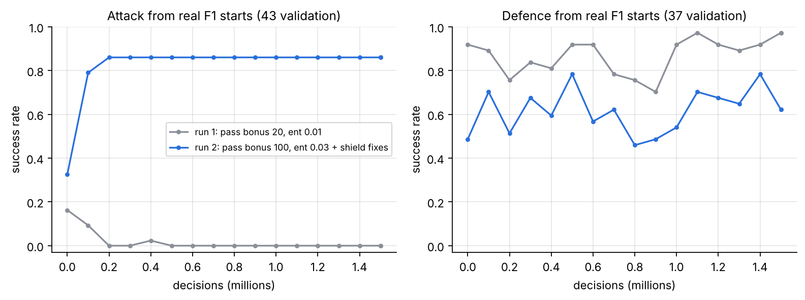{width=100%}

*Fig. 12. Real-start driver, run 1 (overtake bonus 20, entropy coefficient 0.01) vs
run 2 (bonus 100, entropy 0.03, plus shield fixes). Run 1 stops attacking within
0.2M decisions; run 2 attacks on 37/43 starts but defends worse.*

Table: Ablation study

| Component removed or changed | Effect (validation unless noted) |
|---|---|
| Overtake bonus 100 → 20, entropy 0.03 → 0.01 | attack success 37/43 → 0/43 after 0.2M decisions (passive policy) |
| Pass must hold 600 m / 1 km | without it, reported attacks 434/495 fell to 7/49 under strict scoring |
| Safety shield | contacts 0 → 20 on 424 held-out real starts (scripted driver) |
| Shield fixes 1-3 (fallback as candidate, no brake-test, no off-road beside car) | random-move contacts 2 → 1, off-tracks 26 → 3 on 284 starts |
| Shield fix 4 (steer 0.4 → 0.8, horizon 1.5 → 2.5 s) | 18 contacts → 0 in 150 validation defences |
| Move-level actions → raw continuous control (SAC) | gap to limit +1.1% (planner) → +17-20% |
| Optimal-line features added to SAC | no gain (+19-21% vs +19.2%) |
| Air drag + two-corner battles | scripted passes 13 → 23 of 180; off-tracks 18 → 9 |
| Dirty air removed (diagnostic) | scripted passes 23 → 36 of 180 |
| Stay-out prior removed (win-only reward) | no learning: random policy pits 3 laps in 4, never wins |
| Dense race-time reward vs win-only (incident races) | win-only: P10, pitting every lap; dense: P6.9 vs 8.1 baseline |
| Driver profile: strategist trained on rain mix used in dry races | dry wins 25% vs 72% for dry-trained agent |
| Final agent: late-stop and dry-track wet-tyre rules switched off at evaluation (held out) | rain wins 92.0% vs 89.5% with the rules; other cases within 0.5 points; the rules remove unrealistic stops rather than add wins |
| Final agent: last checkpoint instead of the best on validation (held out) | after a spin 48% vs 38.5%, but two SCs 88% vs 94.5%, red flag 93.5% vs 98%, VSC 88.5% vs 91% |
| Earlier → final configuration (early-stop rule, longer and repeated SCs, win bonus 30; several changes at once) | safety-car wins 78% (three-seed mean) → 95.5% |

## 4.6 Robustness, Sensitivity and Generalization

**Robustness (environment changes).**
*Opponent change:* the defending driver was tested against four attacker types,
including a frozen copy of itself; the overtaking driver against slow, guard and
RL-trained defenders. Across all of these opponents the shielded driver recorded
two contacts in 810 held-out battles, both caused by the same scripted attacker at
one corner. Against the RL-trained defender the learned attacker passed 14 of 175
times against 15 for the scripted tactician, so a stronger opponent lowers the
success rate of both drivers alike.
*Failures and events:* the final strategist was evaluated separately on eight race
cases: clean races, spins, punctures, one or two safety cars, VSCs, red flags and
rain (Fig. 13). It wins at least as often as the rule-based plan in every case
except the VSC. In an earlier test with a 3% faster car, the strategist won
99.5-100% in every case except punctures (56% vs 44% for the rule-based plan).
*Forecast error:* the rain agent reads a noisy 3- and 6-lap forecast and still
pitted about one lap before rivals.
*Sensor error:* not tested; observations are exact.

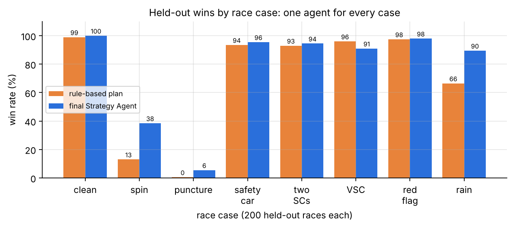{width=90%}

*Fig. 13. Held-out wins of the final Strategy Agent by race case, 200 races each,
1% faster car starting tenth, against the rule-based plan on the same seeded
races.*

**Sensitivity (parameter changes).** With car pace edges of 0.5%, 1% and 3%, the
agent's advantage over the rule-based plan is largest where the race is close (1%:
96% vs 91% clean, 29% vs 4.5% after a spin) and vanishes when the car is so fast
that any sensible plan wins (3%). With a stronger overtaker (pass at a 1.5 s/lap
edge) the agent switched from a clean-air plan to racing through traffic (11.4 vs
7.8 passes per race). Grip-to-lap-time sensitivity: 1% grip ≈ 0.3 s per lap.

**Generalisation.** Driver and strategist were selected on three validation
circuits and tested once on five unseen circuits that differ in layout (Spa's long
straights, Suzuka's esses, Sao Paulo's short lap). The held-out library of real
starts adds unseen *situations* drawn from real races.

# 5. Limitations

* **Simulator fidelity.** The car is a point mass with a friction ellipse, no load
  transfer, no tyre temperature and simplified aerodynamics. Slipstream, dirty air,
  tyre compounds, pit loss, safety-car and weather effects are design values, not
  calibrated F1 figures; a one-race FastF1 tyre fit was not identifiable because
  tyre age and fuel burn are collinear.
* **Data limitations.** Public data has no steering or pedal signals and only
  ~4 Hz positions; 2018-2020 sessions now need a paid login; OpenF1 races have no
  pass locations yet, so only their defences are used.
* **Overtaking ceiling.** At realistic pace gaps (0.4-1.2 s per lap) clean passes
  remain rare for both the learned and the scripted driver; the learned driver does
  not yet beat the scripted tactician on strict attacking.
* **Reward exploitation.** The place-swapping episode shows the reward can be
  gamed; the strict scoring fixes the known case but cannot rule out others.
* **Loose coupling of the hierarchy.** The strategist uses a statistical profile
  of the driver; the driver does not yet receive the push mode as an input, and
  the two levels are not fine-tuned jointly.
* **Rival behaviour.** Strategy rivals follow seeded rule-based plans and never
  react to an undercut, which flatters early stops; there is no cold-tyre out-lap.
* **Statistical scope.** Apart from the three-seed strategy study, results come
  from one seed per configuration, including the final Strategy Agent; the seed
  study itself found a safety-car weakness (78% vs 89.5% wins) that one seed alone
  had hidden. Several of the final agent's margins (safety car, two safety cars,
  red flag) are 0.5-2 points on 200 races and lie within binomial noise;
  validation sets of 30-40 races give wide confidence intervals.
* **Hand-written stop rules.** The final strategist relies on rules that block
  early, late and wet-on-dry stops. They keep the plans realistic but mean that
  part of its behaviour is specified rather than learned, and two of the rules
  were added after training.
* **Computational cost.** Driver training runs at 100-170 decisions per second on
  a laptop CPU, and the shield costs about a third of that, which limited the
  number of driver experiments and seeds.
* **Unresolved failures.** Punctures cannot be recovered with a small pace edge
  (5.5% wins); the final strategist loses more VSC races than the plan (91% vs 96%);
  the defend scenario on held-out circuits succeeded 2/5; lap pace under the full
  tactical layer is +3.1% instead of the 1% target.

**Threats to validity.**
*Internal validity:* the baselines were written by the same team that designed the
agents and the simulator. They were fixed before the held-out evaluation and never
tuned on it, but a stronger hand-written plan, for example one that also brings its
stop forward under a safety car, could narrow the strategy gaps.
*Construct validity:* a win rate against a field of rule-based rivals measures how
well the agent exploits those rivals, not how it would fare against teams that
react to an undercut.
*External validity:* tyre, pit and event constants are uncalibrated design values,
so the learned plans (for example the timing of the undercut) should not be read as
advice for real races.
*Conclusion validity:* driver results rest on one seed, and the battle sets contain a
few hundred episodes. The defence result (273 vs 264 of 460, 59.3% vs 57.4%) lies
within binomial noise and should be read as "at least as good as" the line-holding
baseline; the pass result (49 vs 29 of 350, 14.0% vs 8.3%) is about 2.4 standard
errors apart and is more reliable.

# 6. Conclusion and Future Work

We studied racing as a two-timescale decision problem in which an F1 car must be
driven fast and cleanly while a strategist manages tyres and pit stops through
unpredictable events. The gap we targeted is that end-to-end RL drivers need large
compute and lack hard safety, while RL strategists are trained on fixed lap-time
models unrelated to any real driver. Our system combines a PPO driver that selects
race-craft options on a near-limit path planner, a bilateral predictive shield that
enforces zero contact, a curriculum seeded with real F1 passes, and a PPO
strategist trained on the measured profile of that driver. The experiments
establish four things: flat continuous control (SAC) plateaued at 17-20% off the
limit while the planner-based hierarchy laps within 1.1-3.1%; the shield eliminated
contacts across more than a thousand real held-out situations; the defending driver
improved held-out defences (273 vs 264) and passes (49 vs 29); and the strategist
learned undercuts and event responses that beat a rule-based plan on unseen
circuits. Across three seeds of an earlier configuration the clean-race and
after-spin gains were stable (96.7 ± 1.5% and 29.8 ± 4.0% wins against 91% and
4.5%), while safety-car races exposed a weakness of the race-time reward (78% vs
89.5%). The final configuration, one agent for eight race cases with simple stop
rules, removed that weakness (95.5% vs 93.5% under a safety car) and wins at least
as often as the plan in seven of the eight cases, with the largest gains in the
rain (89.5% vs 66.5%) and after a spin (38.5% vs 13%); it still loses more VSC
races than the plan (91% vs 96%).

Three lessons from this project apply beyond racing. First, the choice of action
space mattered more than the choice of algorithm: the same compute that left a
continuous-control agent 17-20% off the limit produced a competitive driver once the
agent chose manoeuvres and a planner executed them. Second, a score is not a
behaviour: the place-swapping exploit was invisible in the learning curve and was
found only by watching replays, and it was fixed by changing what counts as
success, not by tuning the learner. Third, a single seed can hide a weakness: the
safety-car problem appeared only when the same configuration was trained three
times.

Future work follows from the limitations: calibrate tyre and pit constants from
multi-race FastF1 stints; give the driver the push mode and attack/defend orders as
inputs and fine-tune both levels jointly; replace scripted rivals with a league of
learned opponents and reactive strategists, as in population-based self-play
[4], [14]; add defensive late braking and holding the inside through a corner,
which the oracle analysis identifies as the missing moves; add cold-tyre out-laps,
fuel saving and lapped traffic; send the strategist's overtake-mode calls to the
driver; and repeat the final strategist and every driver experiment over several
seeds with confidence intervals [37], [38].

# References

[1] R. S. Sutton and A. G. Barto, *Reinforcement Learning: An Introduction*, 2nd ed. Cambridge, MA, USA: MIT Press, 2018.

[2] V. Mnih *et al.*, "Human-level control through deep reinforcement learning," *Nature*, vol. 518, no. 7540, pp. 529–533, 2015.

[3] D. Silver *et al.*, "Mastering the game of Go with deep neural networks and tree search," *Nature*, vol. 529, no. 7587, pp. 484–489, 2016.

[4] O. Vinyals *et al.*, "Grandmaster level in StarCraft II using multi-agent reinforcement learning," *Nature*, vol. 575, no. 7782, pp. 350–354, 2019.

[5] J. Kober, J. A. Bagnell, and J. Peters, "Reinforcement learning in robotics: A survey," *Int. J. Robot. Res.*, vol. 32, no. 11, pp. 1238–1274, 2013.

[6] B. R. Kiran *et al.*, "Deep reinforcement learning for autonomous driving: A survey," *IEEE Trans. Intell. Transp. Syst.*, vol. 23, no. 6, pp. 4909–4926, 2022.

[7] E. Kaufmann, L. Bauersfeld, A. Loquercio, M. Müller, V. Koltun, and D. Scaramuzza, "Champion-level drone racing using deep reinforcement learning," *Nature*, vol. 620, no. 7976, pp. 982–987, 2023.

[8] A. Heilmeier, M. Graf, J. Betz, and M. Lienkamp, "Application of Monte Carlo methods to consider probabilistic effects in a race simulation for circuit motorsport," *Appl. Sci.*, vol. 10, no. 12, Art. no. 4229, 2020.

[9] J. Betz *et al.*, "Autonomous vehicles on the edge: A survey on autonomous vehicle racing," *IEEE Open J. Intell. Transp. Syst.*, vol. 3, pp. 458–488, 2022.

[10] A. Heilmeier, A. Thomaser, M. Graf, and J. Betz, "Virtual strategy engineer: Using artificial neural networks for making race strategy decisions in circuit motorsport," *Appl. Sci.*, vol. 10, no. 21, Art. no. 7805, 2020.

[11] A. Liniger, A. Domahidi, and M. Morari, "Optimization-based autonomous racing of 1:43 scale RC cars," *Optim. Control Appl. Methods*, vol. 36, no. 5, pp. 628–647, 2015.

[12] A. Heilmeier, A. Wischnewski, L. Hermansdorfer, J. Betz, M. Lienkamp, and B. Lohmann, "Minimum curvature trajectory planning and control for an autonomous race car," *Veh. Syst. Dyn.*, vol. 58, no. 10, pp. 1497–1527, 2020.

[13] F. Fuchs, Y. Song, E. Kaufmann, D. Scaramuzza, and P. Dürr, "Super-human performance in Gran Turismo Sport using deep reinforcement learning," *IEEE Robot. Autom. Lett.*, vol. 6, no. 3, pp. 4257–4264, 2021.

[14] P. R. Wurman *et al.*, "Outracing champion Gran Turismo drivers with deep reinforcement learning," *Nature*, vol. 602, no. 7896, pp. 223–228, 2022.

[15] A. Liniger and J. Lygeros, "A noncooperative game approach to autonomous racing," *IEEE Trans. Control Syst. Technol.*, vol. 28, no. 3, pp. 884–897, 2020.

[16] A. Kendall *et al.*, "Learning to drive in a day," in *Proc. IEEE Int. Conf. Robot. Autom. (ICRA)*, 2019, pp. 8248–8254.

[17] M. Jaritz, R. de Charette, M. Toromanoff, E. Perot, and F. Nashashibi, "End-to-end race driving with deep reinforcement learning," in *Proc. IEEE Int. Conf. Robot. Autom. (ICRA)*, 2018, pp. 2070–2075.

[18] D. Loiacono *et al.*, "The 2009 simulated car racing championship," *IEEE Trans. Comput. Intell. AI Games*, vol. 2, no. 2, pp. 131–147, 2010.

[19] Y. Song, H. Lin, E. Kaufmann, P. Dürr, and D. Scaramuzza, "Autonomous overtaking in Gran Turismo Sport using curriculum reinforcement learning," in *Proc. IEEE Int. Conf. Robot. Autom. (ICRA)*, 2021, pp. 9403–9409.

[20] R. S. Thakkar, A. S. Samyal, D. Fridovich-Keil, Z. Xu, and U. Topcu, "Hierarchical control for head-to-head autonomous racing," *Field Robot.*, vol. 4, pp. 46–69, 2024.

[21] R. S. Sutton, D. Precup, and S. Singh, "Between MDPs and semi-MDPs: A framework for temporal abstraction in reinforcement learning," *Artif. Intell.*, vol. 112, no. 1–2, pp. 181–211, 1999.

[22] P.-L. Bacon, J. Harb, and D. Precup, "The option-critic architecture," in *Proc. AAAI Conf. Artif. Intell.*, 2017, pp. 1726–1734.

[23] A. S. Vezhnevets *et al.*, "FeUdal networks for hierarchical reinforcement learning," in *Proc. Int. Conf. Mach. Learn. (ICML)*, 2017, pp. 3540–3549.

[24] O. Nachum, S. Gu, H. Lee, and S. Levine, "Data-efficient hierarchical reinforcement learning," in *Adv. Neural Inf. Process. Syst. (NeurIPS)*, 2018, pp. 3303–3313.

[25] J. García and F. Fernández, "A comprehensive survey on safe reinforcement learning," *J. Mach. Learn. Res.*, vol. 16, pp. 1437–1480, 2015.

[26] M. Alshiekh, R. Bloem, R. Ehlers, B. Könighofer, S. Niekum, and U. Topcu, "Safe reinforcement learning via shielding," in *Proc. AAAI Conf. Artif. Intell.*, 2018, pp. 2669–2678.

[27] D. Thomas *et al.*, "Explainable reinforcement learning for Formula One race strategy," in *Proc. ACM/SIGAPP Symp. Appl. Comput. (SAC)*, 2025, doi: 10.1145/3672608.3707766.

[28] G. Fieni, J. Wüthrich, M.-P. Neumann, and C. H. Onder, "Learning-based multi-agent race strategies in Formula 1," arXiv:2602.23056, 2026.

[29] Y. Bengio, J. Louradour, R. Collobert, and J. Weston, "Curriculum learning," in *Proc. Int. Conf. Mach. Learn. (ICML)*, 2009, pp. 41–48.

[30] A. Y. Ng, D. Harada, and S. Russell, "Policy invariance under reward transformations: Theory and application to reward shaping," in *Proc. Int. Conf. Mach. Learn. (ICML)*, 1999, pp. 278–287.

[31] D. A. Pomerleau, "ALVINN: An autonomous land vehicle in a neural network," in *Adv. Neural Inf. Process. Syst. (NIPS)*, 1989, pp. 305–313.

[32] J. Schulman, F. Wolski, P. Dhariwal, A. Radford, and O. Klimov, "Proximal policy optimization algorithms," arXiv:1707.06347, 2017.

[33] T. Haarnoja, A. Zhou, P. Abbeel, and S. Levine, "Soft actor-critic: Off-policy maximum entropy deep reinforcement learning with a stochastic actor," in *Proc. Int. Conf. Mach. Learn. (ICML)*, 2018, pp. 1861–1870.

[34] J. Schulman, P. Moritz, S. Levine, M. Jordan, and P. Abbeel, "High-dimensional continuous control using generalized advantage estimation," in *Proc. Int. Conf. Learn. Represent. (ICLR)*, 2016.

[35] M. Towers *et al.*, "Gymnasium: A standard interface for reinforcement learning environments," arXiv:2407.17032, 2024.

[36] A. Raffin, A. Hill, A. Gleave, A. Kanervisto, M. Ernestus, and N. Dormann, "Stable-Baselines3: Reliable reinforcement learning implementations," *J. Mach. Learn. Res.*, vol. 22, no. 268, pp. 1–8, 2021.

[37] P. Henderson, R. Islam, P. Bachman, J. Pineau, D. Precup, and D. Meger, "Deep reinforcement learning that matters," in *Proc. AAAI Conf. Artif. Intell.*, 2018, pp. 3207–3214.

[38] R. Agarwal, M. Schwarzer, P. S. Castro, A. Courville, and M. G. Bellemare, "Deep reinforcement learning at the edge of the statistical precipice," in *Adv. Neural Inf. Process. Syst. (NeurIPS)*, 2021, pp. 29304–29320.
